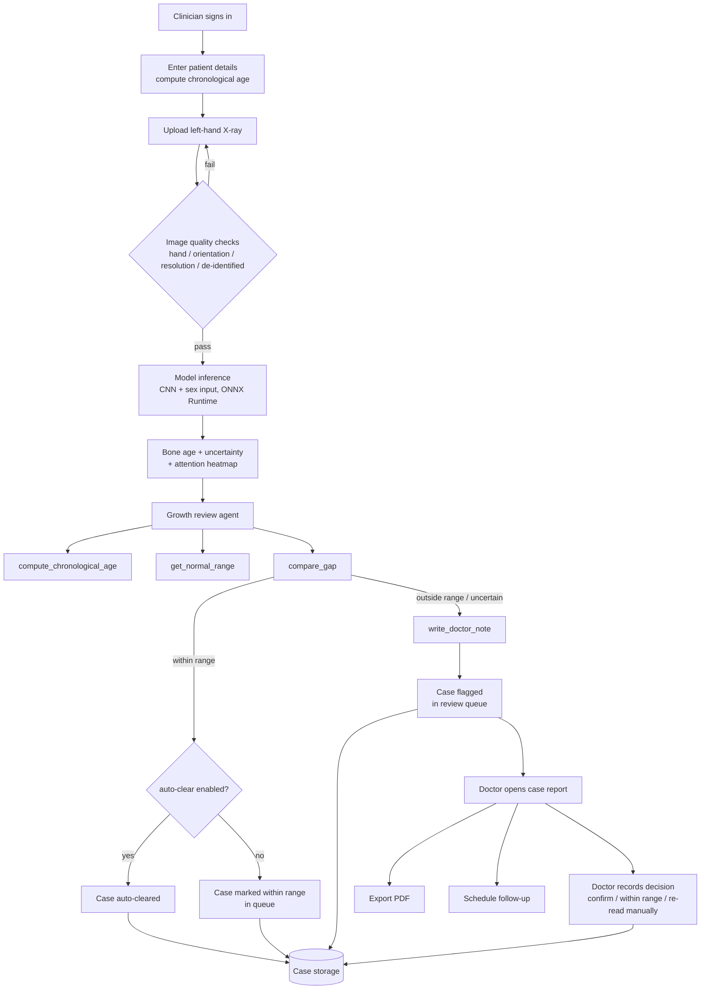

# Architecture

Part of the [BoneAge AI](../README.md) documentation set. See also: [data.md](data.md), [model.md](model.md), [api.md](api.md).

*Tech stack confirmed (see [README.md](../README.md#tech-stack)).*

## System components

- **Frontend** (React + TypeScript + Vite + Tailwind) — all screens from [design.md](design.md): sign in, dashboard, new analysis, review queue, case report, patients, model performance, settings. Themed via shared CSS variable tokens. Hosted on Vercel (its own project).
- **Backend API** (FastAPI) — authentication, patient/case CRUD, image upload handling, orchestrates image quality checks → model inference → growth review agent, serves the review queue and case report data, PDF export, follow-up scheduling. Full endpoint list: [api.md](api.md). Hosted on Vercel as a Python Function (a separate project from the frontend — see [Deployment notes](#deployment-notes) below).
- **Image quality checks** — validates hand detected, orientation, resolution, and that burned-in patient details are removed, before an image is sent to the model.
- **Model inference** — training/evaluation run on PyTorch (`ml/`); the *deployed* backend runs the trained model via **ONNX Runtime** instead (no `torch`/`torchvision` at request time — see [Deployment notes](#deployment-notes) for why). CNN backbone + sex input → bone age (months) + uncertainty estimate (MC dropout); an attention heatmap (Grad-CAM on PyTorch, Score-CAM — a gradient-free stand-in — on the ONNX path). See [model.md](model.md#explainability).
- **Growth review agent** — built on the **OpenAI Agents SDK**; deterministic tools (`compute_chronological_age`, `get_normal_range`, `compare_gap`) plus an LLM-authored explanatory note (`write_doctor_note`) that receives only structured numbers/labels, never images or patient names. Full contract: [AGENTS.md](../AGENTS.md#the-growth-review-agent).
- **Case storage** — relational DB (SQLite for local dev/tests; Postgres via Neon in production) for patients, cases, predictions, agent outputs, doctor decisions; image storage (local disk for local dev/tests; Vercel Blob in production) for X-ray images and generated heatmaps. Default retention: 30 days, enforced by a Vercel Cron job (`GET /internal/retention-cleanup`).
- **Review queue** — a query/view over case storage filtered by flag status.

## Data flow: upload to doctor decision

1. Clinician signs in (frontend → backend auth).
2. Clinician enters patient details; frontend computes/display chronological age from date of birth + X-ray date (and backend recomputes/validates server-side).
3. Clinician uploads the X-ray; backend runs image quality checks.
   - Fail → case blocked/flagged for re-upload, with the specific issue shown.
   - Pass → proceed.
4. Backend sends image + sex to the model inference path (ONNX Runtime in production; see [Deployment notes](#deployment-notes)).
5. Inference returns bone age, uncertainty, and an attention heatmap.
6. Backend passes bone age, uncertainty, sex, and computed chronological age to the growth review agent.
7. Agent runs its deterministic tools to compute the gap against the configured normal range:
   - Within range → case marked within range; auto-cleared if that setting is enabled.
   - Outside range, or uncertainty above threshold → case flagged; agent writes a doctor note.
8. Case (with prediction, heatmap, agent output) is written to storage and, if flagged (or always, depending on settings), appears in the review queue.
9. Doctor opens the case report, reviews X-ray/heatmap/measurements/agent reasoning/history, and records a decision (confirm flag / within expected range / model looks wrong) with optional manual reading and notes.
10. Doctor may export a PDF report and/or schedule a follow-up scan — both update case storage.

## Diagram

## Deployment notes

- **Hosting:** frontend and backend are both deployed to **Vercel**, as two separate projects from this one repo (Root Directory `frontend/` and `backend/` respectively) — no Render, no Docker. A **local fallback** (everything run on a laptop) is kept ready in case the live demo venue has unreliable internet.
- **Why the backend runs on ONNX Runtime, not PyTorch:** Vercel's Python Functions have a 500 MB uncompressed bundle size limit. `torch` + `torchvision` alone measure ~750 MB uncompressed (verified by extracting the actual Linux wheels) — already over the limit before anything else is counted. `ml/export_onnx.py` exports a trained checkpoint to three ONNX graphs (backbone+activations, and the two head layers either side of each Dropout — see `ml/boneage/onnx_export.py`'s module docstring for why three, not one); the backend's `app/inference_adapter.py` runs MC-dropout uncertainty and Score-CAM (`ml/boneage/score_cam.py`, a gradient-free Grad-CAM stand-in — see [model.md#explainability](model.md#explainability)) entirely via ONNX Runtime + numpy, bringing the deployed bundle to roughly 270 MB. `torch`/`torchvision`/`pandas`/`matplotlib` stay in `ml/requirements.txt` (training-time only) and `backend/requirements-dev.txt` (test-time only, see `backend/README.md`) — never in `backend/requirements.txt`, which is what Vercel actually deploys.
- **Database:** SQLite for local dev/tests (default, zero setup); Postgres (Neon, via the Vercel Marketplace) in production — both go through the same Alembic migration chain (`backend/migrations/`), normalised to the `psycopg` driver in `app/database.py`. Migrations run from GitHub Actions against the production DB, not from the deployed function (Vercel's Python Functions have no pre-start hook to run them from — see the deploy workflow's `migrate-backend-db` job).
- **Image storage:** local disk for local dev/tests (default); Vercel Blob in production, selected automatically by the presence of `BLOB_READ_WRITE_TOKEN` (see `app/storage.py`). Blobs are stored `access="private"` — the frontend only ever reaches images through the backend's own authenticated `/cases/{id}/...` endpoints, same as the local-disk path.
- **Retention cleanup** runs as a Vercel Cron job (`backend/vercel.json`'s `crons`, daily) calling `GET /internal/retention-cleanup`, guarded by a shared secret (`CRON_SECRET`) rather than a user JWT — see `app/routers/internal.py`.
- **Model checkpoint delivery:** the exported ONNX directory is gitignored (like the old `.pt` checkpoint) and fetched lazily from `ONNX_DOWNLOAD_URL` on the first real prediction request after a cold start, since there's no separate startup step to run it from ahead of time (see `app/inference_adapter.py`). Until a URL is configured (or if the download fails), the API transparently falls back to the clearly-labelled mock predictor.
- Secrets (LLM API keys, DB credentials, the Blob token) via environment variables on each Vercel project (never committed) — see [README.md#deployment-setup-vercel--github-actions](../README.md#deployment-setup-vercel--github-actions) for the full list.
- Demo uses dataset images only (RSNA/DHA/RHPE samples) — no real patient data, even for the local fallback.
- Pre-demo checklist: seed a handful of sample cases (mix of flagged/normal) so the review queue and case report aren't empty during the live demo; verify the local fallback works end-to-end before demo day.
- CI/CD: GitHub Actions run the ml/backend/frontend test suites and the frontend build on every push/PR, then apply DB migrations and deploy both Vercel projects after CI passes on `main` — see [README.md#deployment-setup-vercel--github-actions](../README.md#deployment-setup-vercel--github-actions) for the one-time setup and [demo-script.md](demo-script.md) for the judge walkthrough.
