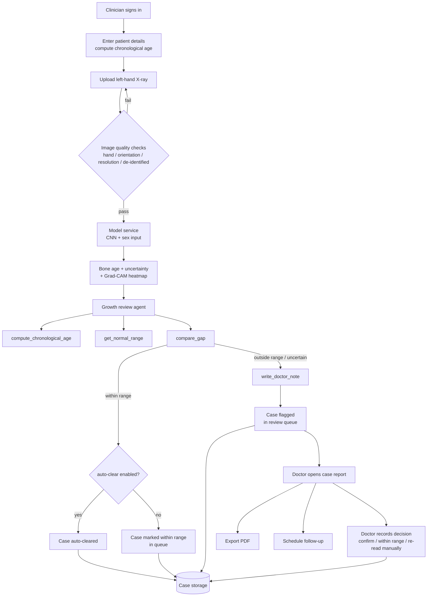

# Architecture

Part of the [BoneAge AI](../README.md) documentation set. See also: [data.md](data.md), [model.md](model.md), [api.md](api.md).

*Tech stack confirmed (see [README.md](../README.md#tech-stack)).*

## System components

- **Frontend** (React + TypeScript + Vite + Tailwind) — all screens from [design.md](design.md): sign in, dashboard, new analysis, review queue, case report, patients, model performance, settings. Themed via shared CSS variable tokens. Hosted on Vercel.
- **Backend API** (FastAPI) — authentication, patient/case CRUD, image upload handling, orchestrates image quality checks → model inference → growth review agent, serves the review queue and case report data, PDF export, follow-up scheduling. Full endpoint list: [api.md](api.md). Hosted on Render.
- **Image quality checks** — validates hand detected, orientation, resolution, and that burned-in patient details are removed, before an image is sent to the model.
- **Model service** (PyTorch) — CNN backbone + sex input → bone age (months) + uncertainty estimate (MC dropout); Grad-CAM heatmap generation. See [model.md](model.md). Hosted alongside the backend on Render.
- **Growth review agent** — built on the **OpenAI Agents SDK**; deterministic tools (`compute_chronological_age`, `get_normal_range`, `compare_gap`) plus an LLM-authored explanatory note (`write_doctor_note`) that receives only structured numbers/labels, never images or patient names. Full contract: [AGENTS.md](../AGENTS.md#the-growth-review-agent).
- **Case storage** — relational DB (SQLite or Postgres) for patients, cases, predictions, agent outputs, doctor decisions; local/object storage for X-ray images and generated heatmaps. Default retention: 30 days.
- **Review queue** — a query/view over case storage filtered by flag status.

## Data flow: upload to doctor decision

1. Clinician signs in (frontend → backend auth).
2. Clinician enters patient details; frontend computes/display chronological age from date of birth + X-ray date (and backend recomputes/validates server-side).
3. Clinician uploads the X-ray; backend runs image quality checks.
   - Fail → case blocked/flagged for re-upload, with the specific issue shown.
   - Pass → proceed.
4. Backend sends image + sex to the model service.
5. Model service returns bone age, uncertainty, and a Grad-CAM heatmap.
6. Backend passes bone age, uncertainty, sex, and computed chronological age to the growth review agent.
7. Agent runs its deterministic tools to compute the gap against the configured normal range:
   - Within range → case marked within range; auto-cleared if that setting is enabled.
   - Outside range, or uncertainty above threshold → case flagged; agent writes a doctor note.
8. Case (with prediction, heatmap, agent output) is written to storage and, if flagged (or always, depending on settings), appears in the review queue.
9. Doctor opens the case report, reviews X-ray/heatmap/measurements/agent reasoning/history, and records a decision (confirm flag / within expected range / model looks wrong) with optional manual reading and notes.
10. Doctor may export a PDF report and/or schedule a follow-up scan — both update case storage.

## Diagram

## Deployment notes (hackathon demo)

- **Hosting:** frontend deployed on **Vercel**; backend + model service deployed on **Render**. A **local fallback** (everything run on a laptop) is kept ready in case the live demo venue has unreliable internet.
- Single-environment demo deployment is sufficient — no multi-region, no auto-scaling needed for a hackathon demo.
- Suggested shape: frontend static build on Vercel + one backend process + one model-serving process (can be in-process with the backend for simplicity, or a separate service if the model is heavy) on Render + a single DB instance (SQLite is enough for a demo; Postgres if the team prefers).
- Images can be stored on local disk for the demo; object storage (S3-compatible) only if time allows.
- Secrets (LLM API keys, DB credentials) via environment variables / `.env`, never committed.
- Demo uses dataset images only (RSNA/DHA/RHPE samples) — no real patient data, even for the local fallback.
- Pre-demo checklist: seed a handful of sample cases (mix of flagged/normal) so the review queue and case report aren't empty during the live demo; verify the local fallback works end-to-end before demo day.
- CI/CD: GitHub Actions run the ml/backend/frontend test suites and the frontend build on every push/PR, then deploy to Vercel + Render after CI passes on `main` — see [README.md#deployment-setup-vercel--render--github-actions](../README.md#deployment-setup-vercel--render--github-actions) for the one-time setup and [demo-script.md](demo-script.md) for the judge walkthrough.
